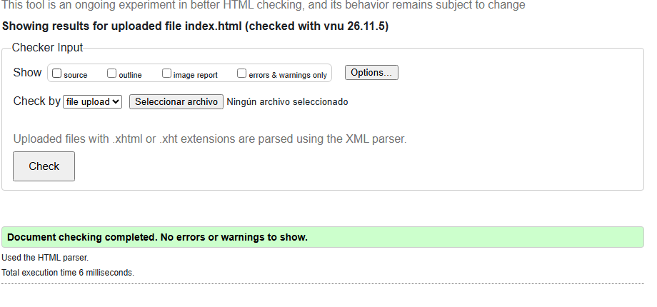
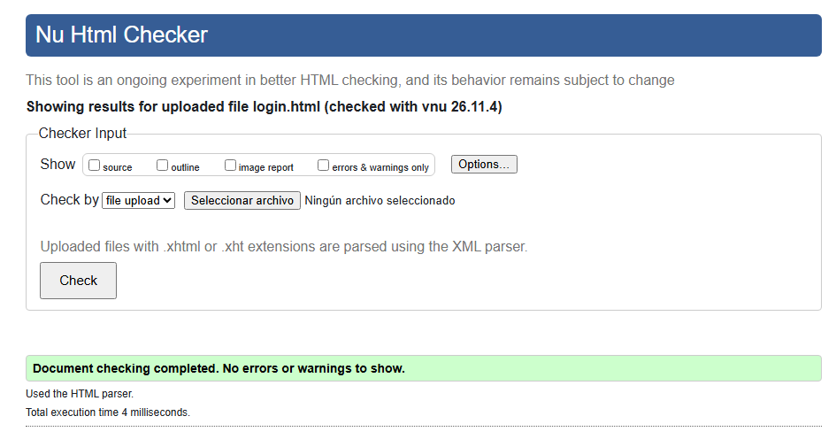
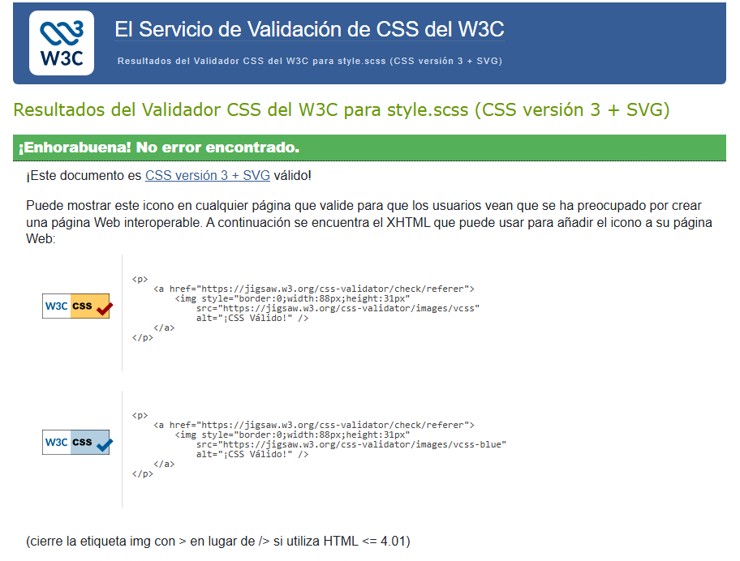
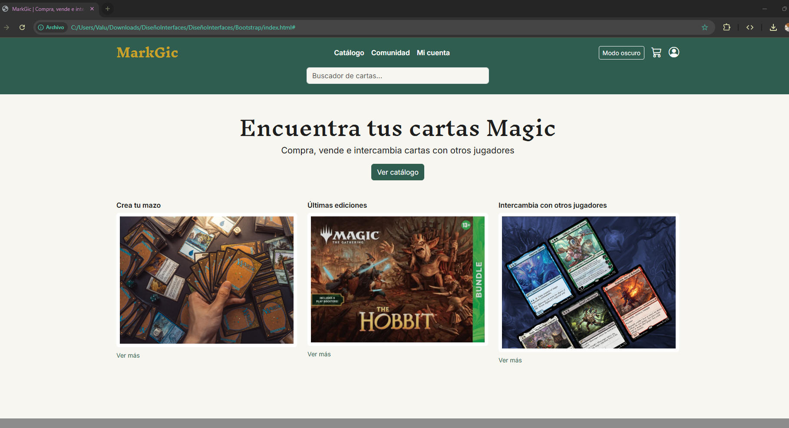
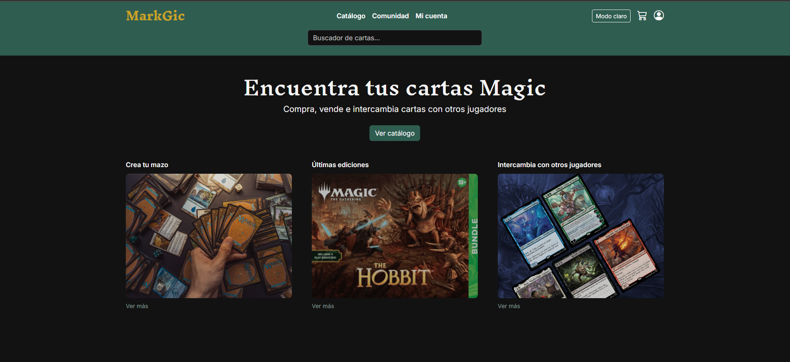

# MarkGic

Web para comprar, vender e intercambiar cartas de Magic: The Gathering. Práctica RA2 de Diseño de Interfaces Web (2º DAW): maquetación del diseño hecho en Figma con HTML semántico, Bootstrap 5.3, Sass y JavaScript.

**Autora:** Valentina Solar

## Tecnologías

- HTML5 semántico
- Bootstrap 5.3.8 (archivos fuente Sass en local)
- Sass modular, compilado con Live Sass Compiler
- JavaScript para el modo claro/oscuro y la validación del formulario
- Bootstrap Icons y Google Fonts (Inknut Antiqua e Inter)

## Páginas

- `index.html`: página de inicio con buscador, portada y destacados.
- `login.html`: inicio de sesión con validación del formulario.

## Estructura de carpetas

```
markgic/
├── index.html
├── login.html
├── css/
│   └── style.css          ← generado por Sass, no se edita a mano
├── js/
│   ├── bootstrap.bundle.min.js
│   └── script.js          ← modo oscuro y validación
├── scss/
│   ├── bootstrap/         ← código fuente de Bootstrap 5.3.8
│   ├── partials/          ← mis estilos
│   │   ├── _variables.scss
│   │   ├── _mixins.scss
│   │   ├── _header.scss
│   │   ├── _botones.scss
│   │   ├── _tarjetas.scss
│   │   ├── _footer.scss
│   │   ├── _login.scss
│   │   └── _tema-oscuro.scss
│   └── style.scss         ← archivo principal, solo hace @import
├── img/
└── capturas/
```

## Cómo compilar el Sass

1. Abrir la carpeta del proyecto en VS Code.
2. Instalar la extensión **Live Sass Compiler** (de Glenn Marks).
3. Pulsar **Watch Sass** en la barra de estado. La configuración de `.vscode/settings.json` genera un único archivo: `css/style.css`.

También se puede compilar desde la terminal:

```bash
npx sass scss/style.scss css/style.css
```

Los avisos de "deprecated" que salen al compilar vienen del propio código de Bootstrap 5.3 (uso de `@import` y de funciones antiguas de Sass) y no afectan al resultado.

## Decisiones técnicas

- **Variables antes de Bootstrap:** `partials/_variables.scss` se importa antes que Bootstrap. Como las variables de Bootstrap usan `!default`, toman los colores y las fuentes de MarkGic sin necesidad de `!important`.
- **Bootstrap separado de mi código:** Bootstrap vive en `scss/bootstrap/` y mis estilos en `scss/partials/`, para que se vea claro qué es de la librería y qué es propio.
- **Modo oscuro:** `script.js` cambia el atributo `data-bs-theme` de `<html>` y guarda la preferencia en `localStorage`. Los colores oscuros se definen con `$body-bg-dark` y `$body-color-dark`, y los ajustes propios con el mixin `color-mode(dark)` de Bootstrap.
- **Validación del formulario:** el formulario usa `novalidate` y los atributos de HTML5 (`required`, `minlength`). El script añade la clase `was-validated` para que Bootstrap muestre los errores con los colores de la marca.
- **Responsive:** enfoque mobile-first con la rejilla de 12 columnas (`col-12 col-md-4`), navbar con menú hamburguesa y el mixin `media-breakpoint-down(sm)` en el login.
- **Accesibilidad:** etiquetas semánticas, un solo `<h1>` por página, `label` asociados a cada campo, `aria-label` en los iconos y estilos `:focus-visible` para la navegación con teclado.

## Validación W3C

### HTML





### CSS



## Capturas






